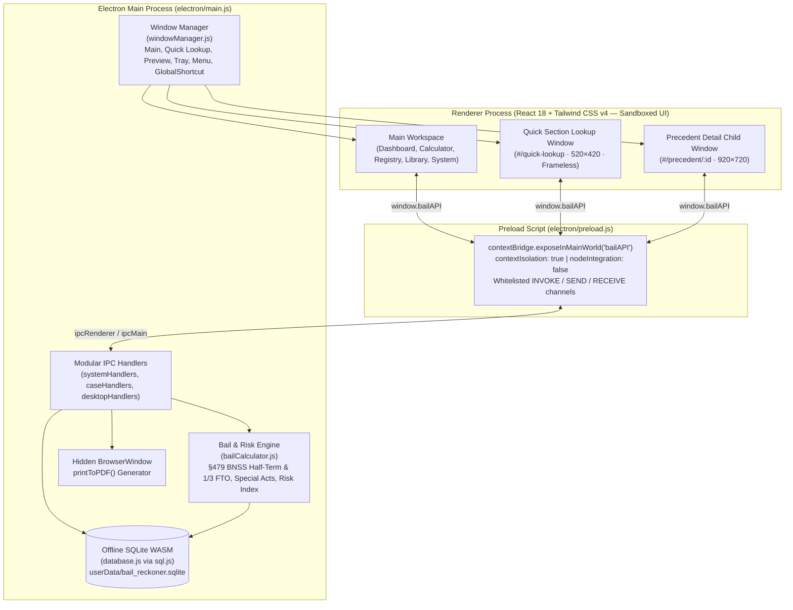

# Bail Reckoner Desktop (`SIH1702`)

An offline-first, cross-platform **Electron + React + Vite + Tailwind CSS** desktop application designed to evaluate bail eligibility, assess judicial risk factors, track statutory custody timelines (`§479 BNSS` / `§436A CrPC`), and generate formal bail reports for Indian criminal jurisprudence.

---

## 1. Problem Statement Summary (`SIH1702`)

Under-trial prisoners often remain incarcerated well past statutory eligibility milestones due to fragmented case records, complex multi-statute charge combinations, and lack of accessible eligibility tracking across stakeholders.

**Bail Reckoner Desktop** addresses **SIH1702** by providing a unified, zero-internet decision-support desktop workspace tailored to three key stakeholders:

1. **Legal Aid Providers (DLSA / NALSA Advocates):** Multi-charge bail calculation, statutory threshold scanning, matched Supreme Court precedents, and 1-click PDF Bail Report / Draft Prayer export.
2. **Judicial Authorities (Magistrates / Sessions / Special Courts):** Interactive *Judge's Discretion Risk Index* (Flight Risk, Witness Influence, Evidence Tampering, Prior Convictions, Verified Local Ties), special-statute overrides (`PMLA §45`, `UAPA §43D(5)`, `POCSO`, `SC/ST Act §14A`), and procedural bond compliance checks.
3. **Undertrial Prisoners:** Simplified plain-language eligibility guide explaining *"Am I Eligible?"*, *"When will I become eligible?"*, and a step-by-step checklist of documents required to apply for bail.

---

## 2. System Architecture



### Security Model
- `contextIsolation: true`, `nodeIntegration: false`, `webSecurity: true` across all `BrowserWindow` instances.
- Strict channel allowlists (`INVOKE_CHANNELS`, `SEND_CHANNELS`, `RECEIVE_CHANNELS`) in `electron/preload.js`.
- External URLs restricted to `http://` / `https://` via `shell.openExternal()`, and renderer navigation locked to the app origin (`will-navigate` + `setWindowOpenHandler`).

---

## 3. Electron Desktop APIs & Source Reference

| Electron / Desktop API | Purpose in Bail Reckoner | Exact File & Line Reference |
|---|---|---|
| **`app` Lifecycle & Security Guards** | Awaits `initDatabase()`, boots `initWindowManager()`, runs startup Bail Scan, handles `window-all-closed`, blocks untrusted navigation (`will-navigate`). | [`electron/main.js#L35-L78`](electron/main.js) |
| **`contextBridge` & `ipcRenderer`** | Exposes typed `window.bailAPI` with strict channel allowlists (`safeInvoke`, `safeSend`, `safeOn`). | [`electron/preload.js#L21-L197`](electron/preload.js) |
| **`BrowserWindow` (Main Window)** | Persistent size/position/maximized state saved to `userData/window-state.json`; `hiddenInset` macOS titlebar; `minWidth: 1100`, `minHeight: 720`. | [`electron/windows/windowManager.js#L157-L210`](electron/windows/windowManager.js) |
| **`BrowserWindow` (Quick Lookup Floating)** | Frameless, `alwaysOnTop`, `skipTaskbar`, vibrancy spotlight popup routed to `#/quick-lookup`; auto-hides on blur. | [`electron/windows/windowManager.js#L215-L263`](electron/windows/windowManager.js) |
| **`BrowserWindow` (Precedent Child Window)** | Child window (`920×720`, parented to Main Window) routed dynamically to `#/precedent/:id` or `#preview`. | [`electron/windows/windowManager.js#L268-L316`](electron/windows/windowManager.js) |
| **`globalShortcut`** | Registers `CommandOrControl+Shift+B` globally to toggle Quick Section Lookup; calls `unregisterAll()` on `will-quit`. | [`electron/windows/windowManager.js#L524-L532`](electron/windows/windowManager.js), [`#L553-L556`](electron/windows/windowManager.js) |
| **`Tray` + `nativeImage`** | Builds a 22×22 RGBA balance-scale template PNG programmatically via zlib/CRC32 and attaches tray context menu. | [`electron/windows/windowManager.js#L46-L123`](electron/windows/windowManager.js), [`#L320-L372`](electron/windows/windowManager.js) |
| **`Menu` (Native Application Menu)** | File (`New Case`, `Import Case JSON`, `Export PDF`), Edit, View (`Toggle Theme`, `DevTools`, Zoom), Tools (`Quick Lookup`, `Bail Scan`), Help (`India Code`, `SCI`). | [`electron/windows/windowManager.js#L376-L520`](electron/windows/windowManager.js) |
| **`nativeTheme`** | Persists & cycles `system` / `dark` / `light`, broadcasts `app:theme-changed` to all open `BrowserWindow`s. | [`electron/windows/windowManager.js#L345-L356`](electron/windows/windowManager.js), [`electron/ipc/desktopHandlers.js#L391-L409`](electron/ipc/desktopHandlers.js) |
| **`Notification`** | Fires native desktop alerts on startup / manual Bail Scan (clicking opens Main Window to that case) and on PDF export (clicking opens folder). | [`electron/ipc/desktopHandlers.js#L92-L106`](electron/ipc/desktopHandlers.js), [`#L446-L450`](electron/ipc/desktopHandlers.js) |
| **`webContents.printToPDF()`** | Hidden off-screen `BrowserWindow` renders official HTML Bail Report & Draft Prayer and prints to A4 PDF. | [`electron/ipc/desktopHandlers.js#L120-L356`](electron/ipc/desktopHandlers.js) |
| **`dialog` (`showSaveDialog` / `showOpenDialog` / `showMessageBox`)** | Native file save/open dialogs for PDF Bail Reports, Case JSON import/export, and native About dialog. | [`electron/ipc/desktopHandlers.js#L434-L509`](electron/ipc/desktopHandlers.js), [`electron/windows/windowManager.js#L395-L483`](electron/windows/windowManager.js) |
| **`shell` (`openExternal` / `showItemInFolder`)** | Opens India Code / SCI / NALSA portals in the OS browser (`https://` validated) and reveals exported PDFs or SQLite DB in Finder/Explorer. | [`electron/ipc/desktopHandlers.js#L515-L525`](electron/ipc/desktopHandlers.js) |
| **`clipboard`** | Writes statute citations, precedent citations, case summaries, and DB paths to OS clipboard via `desktop:copyToClipboard`. | [`electron/ipc/desktopHandlers.js#L411-L414`](electron/ipc/desktopHandlers.js) |
| **`ipcMain` (System, DB & Engine IPC)** | Exposes `system:getInfo`, `db:statutes:*`, `db:pronouncements:*`, `db:cases:*`, `db:dashboard:stats`, `bail:analyze`, `bail:preview`. | [`electron/ipc/systemHandlers.js#L18-L28`](electron/ipc/systemHandlers.js), [`electron/ipc/caseHandlers.js#L20-L122`](electron/ipc/caseHandlers.js) |
| **Offline SQLite (`sql.js` WASM)** | Pure-WASM SQLite persisted to `app.getPath('userData')/bail_reckoner.sqlite` with 48 statutory provisions (IPC, BNS/BNSS/BSA 2023, 7 Special Statutes), 11 SC judgments, and 5 seeded cases. | [`electron/db/database.js#L497-L556`](electron/db/database.js) |
| **Bail Calculation Engine** | Pure statutory & risk computation (`§479 BNSS` Half-Term & 1/3 FTO, `§480 BNSS` Bailable right, `PMLA §45`, `UAPA §43D(5)`, `POCSO`, weighted risk index). | [`electron/engine/bailCalculator.js#L108-L601`](electron/engine/bailCalculator.js) |

---

## 4. Database & Legal Coverage

- **Statutes (`statutes_sections`):** 48 provisions spanning **IPC 1860**, **BNS 2023**, **BNSS 2023**, **BSA 2023**, **Cyber / IT Act**, **SC/ST (PoA) Act**, **Women Protection Statutes**, **POCSO Act**, **UAPA (State Offences)**, **PMLA (Economic Offences)**, and **Foreigners Act**.
- **Judicial Pronouncements (`judicial_pronouncements`):** 11 landmark Supreme Court decisions including *Satender Kumar Antil v. CBI*, *Arnesh Kumar v. State of Bihar*, *Sanjay Chandra v. CBI*, *Bhim Singh v. Union of India*, *Hussainara Khatoon v. State of Bihar*, *Nikesh Tarachand Shah v. Union of India*, *Dataram Singh v. State of UP*, *State of Rajasthan v. Balchand*, *P. Chidambaram v. ED*, *Union of India v. K.A. Najeeb*, and *Gurbaksh Singh Sibbia v. State of Punjab*.
- **Persistence:** Zero-native-compilation `sql.js` WASM database automatically persisted to `userData/bail_reckoner.sqlite`.

---

## 5. Setup, Development & Build Commands

### Prerequisites
- Node.js `>= 18` and npm `>= 9`

### Install Dependencies
```bash
npm install
```

### Run in Development Mode (Vite + Electron)
```bash
npm run dev
```
> Starts Vite on `http://localhost:5173`, waits for readiness via `wait-on`, and launches Electron with `ELECTRON_ENV=development`.
> *(Note: if launching from an environment that sets `ELECTRON_RUN_AS_NODE=1`, run `env -u ELECTRON_RUN_AS_NODE npm run dev`.)*

### Production Frontend Build
```bash
npm run build
```

### Package Native Installers (`electron-builder`)
```bash
# Package for current OS
npm run package

# Platform-specific targets
npm run package:mac     # macOS .dmg (arm64 + x64)
npm run package:win     # Windows NSIS .exe (x64)
npm run package:linux   # Linux .AppImage (x64)
```

---

## 6. Keyboard Shortcuts

| Shortcut | Action |
|---|---|
| `Cmd/Ctrl + Shift + B` | Global OS shortcut — Toggle Quick Section Lookup window |
| `Cmd/Ctrl + N` | New Case in Bail Calculator |
| `Cmd/Ctrl + E` | Export Active Case as formal A4 PDF |
| `Cmd/Ctrl + Shift + S` | Run Statutory Bail Scan across all undertrial cases |
| `Cmd/Ctrl + Shift + D` | Cycle Dark / Light / System theme |
| `Esc` | Close Quick Lookup window / Precedent window / Modals |
